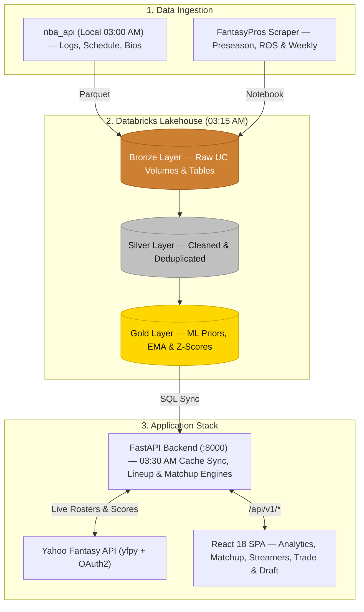

# 9Cat Hoops Analyzer

A full-stack analytics workbench for Yahoo Fantasy Basketball 9-category head-to-head leagues that combines live Yahoo league data with NBA player projections stored in Databricks. Instead of evaluating rosters on raw per-game averages, it models punt builds, daily active-slot constraints, remaining NBA schedules, and category variance to quantify how draft picks, waiver streamers, and trades change weekly win probabilities.

## Tech Stack

- **Backend:** Python 3.13, FastAPI, Pydantic v2, Uvicorn, APScheduler, `yfpy` (Yahoo Fantasy Sports API), SciPy (`linear_sum_assignment` bipartite lineup solver), NumPy, Pandas, `databricks-sql-connector`
- **Frontend:** React 18, React Router v6, Vite 5, modular CSS, native SVG/canvas charts
- **Data Pipeline:** Python batch ingestion (`nba_api`, `databricks-sdk`, PyArrow/Parquet) writing Bronze NBA game logs, schedules, and player bios to Databricks to serve `nba_fantasy.gold.*` projection tables
- **Deployment:** Docker Compose (`backend` FastAPI container + `frontend` multi-stage Node/Nginx reverse proxy)

## System Architecture



### Data Pipeline & Statistical Modeling

The data and modeling layer runs on a staggered daily schedule (`03:00 AM` local ingestion -> `03:15 AM` Databricks ETL -> `03:30 AM` backend cache sync):

1. **Bronze Ingestion (`nba_fantasy.bronze` & UC Volumes):** Because `stats.nba.com` blocks cloud data-center IPs, a scheduled local `launchd` job (`data_eng/`) extracts completed daily game logs, weekly schedules, and player bio data from `nba_api` at 03:00 AM and uploads Parquet files to Databricks Unity Catalog Volumes. In parallel, a Databricks notebook scrapes FantasyPros preseason, rest-of-season (ROS), and weekly projections into Bronze tables.
2. **Silver Cleansing (`nba_fantasy.silver`):** Databricks Auto Loader streams incremental game logs into `nba_game_logs`, while batch pipelines deduplicate and type-cast (`try_cast`) schedules, bios, and projections into Silver tables.
3. **Gold Projections & Iterative Z-Score Rankings (`nba_fantasy.gold`):**
   - **Preseason Zero-State Baseline:** Historical season priors (`player_season_priors`) and FantasyPros projections feed log-linear / MLflow variance models (`zero_state_projections`) to predict each player's baseline per-game mean and variance across all 9 categories, plus shooting makes and attempts.
   - **Intra-Season EMA Updates:** At 03:15 AM daily, `ema_gold` updates player means and variances from new game logs using an Exponential Moving Average (`μ_t = (1 - α) * μ_{t-1} + α * x_t`) and credibility-weighted variance blending. Season rollovers are tracked via the `ema.last_season_id` Delta table property.
   - **Iterative Z-Score Convergence:** Preseason, ROS, and weekly rankings are computed via `rerank_until_stable`, which iteratively recomputes category Z-scores (including volume-weighted FG% and FT% impact) until the top player pool stabilizes.
4. **Matchup, Lineup & Streamer Simulation (FastAPI Backend):**
   - **Optimal Lineup Solver:** Uses the Hungarian algorithm (`scipy.optimize.linear_sum_assignment`) to assign active roster slots (`PG`, `SG`, `G`, `SF`, `PF`, `F`, `C`, `Util`) for each remaining day of the matchup week.
   - **Win Probability Engines:** Supports both a closed-form **Analytical Engine** (Normal distribution difference of means/variances with delta-method ratio variance for `FG%` and `FT%`) and a 10,000-trial **Monte Carlo Simulator** (Normal for high-volume stats, Poisson/Negative Binomial for counting stats, and Beta-Binomial for shooting percentages), combined with live mid-week Yahoo scoreboard totals.

## Repository Architecture

```text
9Cat-Hoops-Analyzer/
├── backend/
│   ├── api/
│   │   ├── routes/           # Versioned FastAPI routers mounted at /v1
│   │   ├── dependencies.py   # Shared app-state cache injectors
│   │   └── error_handler.py  # Request-ID middleware and standardized JSON error responses
│   ├── controllers/          # Input validation, workflow orchestration, HTTP error mapping
│   ├── core/                 # Env configuration (config.py), typed exceptions, logging
│   ├── schemas/              # Pydantic request/response contracts
│   ├── services/             # Databricks SQL cache, Yahoo client, SciPy lineup solver, matchup/streamer engines
│   ├── analysis.py           # 9-category Z-score and punt calculations
│   ├── models.py             # Yahoo league/team/player domain models
│   └── main.py               # FastAPI app factory and APScheduler daily cache refresh
├── frontend/
│   ├── nginx.conf            # Static SPA serving and /api/* proxy to backend:8000
│   ├── vite.config.js        # Local dev proxy (/api -> http://127.0.0.1:8000)
│   └── src/
│       ├── services/         # Centralized fetch wrapper (apiClient.js) and session cache helpers
│       ├── hooks/            # League state synchronization (useTeamData.js)
│       ├── pages/            # Route-level views (Home, Your Team, Rankings, Matchup, Streamers, Trade, Draft, Info)
│       ├── components/       # UI modules grouped by domain (common, draft, matchup, streamer, trade)
│       └── utils/            # Client-side draft, trade win-probability, and Z-score engines
├── data_eng/                 # Batch ETL scripts (backfill, daily logs, weekly schedule/bio ingestion)
└── compose.yaml              # Multi-container orchestration
```

## API Endpoint Reference

All FastAPI routes under `/v1` are exposed directly on port `8000` (and proxied under `/api/v1/*` by both Vite dev server and Nginx in Docker). Interactive OpenAPI docs are available at `/docs`.

| Method | Endpoint | Description |
| :--- | :--- | :--- |
| `GET` | `/` | Returns service metadata (`name`, `version`, and `/docs` path). |
| `GET` | `/v1/health` | Checks whether Databricks projection tables and NBA schedule caches are ready (`503` if still loading). |
| `POST` | `/v1/leagues/sync` | Validates a Yahoo Fantasy NBA team URL, syncs teams and rosters via `yfpy`, and returns enriched league stats. |
| `GET` | `/v1/draft/pool` | Returns the standalone NBA draft projection pool (`preseason`, `ros`, `ema`) without requiring a Yahoo league link (`limit`: `1`–`600`). |
| `POST` | `/v1/leagues/{league_id}/matchups/{week_num}/projections` | Projects 9-category matchup win probabilities (analytical Normal approximation or Monte Carlo) with optimal daily lineups and live scoreboard totals. |
| `POST` | `/v1/leagues/{league_id}/matchups/{week_num}/streamers` | Evaluates waiver wire targets against candidate drop slots using remaining weekly games, punt filters, injury discounts, and ROS protection. |
| `POST` | `/v1/leagues/{league_id}/free-agents/search` | Fetches available league free agents from Yahoo and pairs them with Databricks projections for trade and waiver analysis. |

## Local Setup and Running

### Prerequisites

- **Python 3.13+** and **Poetry** (or Docker Desktop)
- **Node.js 20+** and **npm**
- Yahoo Developer OAuth2 application credentials (`YAHOO_CONSUMER_KEY`, `YAHOO_CONSUMER_SECRET`)
- Access to a Databricks SQL Warehouse serving the `nba_fantasy.gold.*` projection and schedule tables

### 1. Configure Environment Variables

Create a `.env` file in the repository root with your Databricks SQL Warehouse and Yahoo OAuth2 credentials, and create the Yahoo auth directory:

```bash
touch .env
mkdir -p yahoo_auth
```

Place your Yahoo OAuth token artifacts in `./yahoo_auth` as expected by `yfpy`. When running outside Docker, leave `YAHOO_AUTH_DIR` unset (it defaults to `./yahoo_auth`); inside Docker, `compose.yaml` mounts `./yahoo_auth` to `/app/auth`.

### 2. Run with Docker Compose

Builds the Python backend and Nginx-served React frontend containers:

```bash
docker compose up --build
```

- Frontend: `http://localhost:5500`
- Backend API & OpenAPI docs: `http://localhost:8000/docs`

Stop containers with `docker compose down`.

### 3. Run Locally for Development

**Backend** (from the repository root):

```bash
poetry install
poetry run uvicorn backend.main:app --reload --host 127.0.0.1 --port 8000
```

**Frontend** (in a separate terminal):

```bash
cd frontend
npm install
npm run dev
```

- Frontend dev server: `http://localhost:5173` (requests to `/api/*` are proxied to `http://127.0.0.1:8000`)

### 4. Verification Checks

Build the frontend production bundle:

```bash
npm --prefix frontend run build
```
